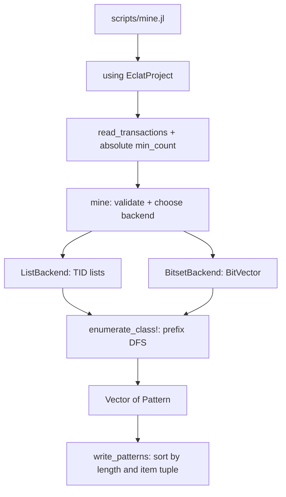

# Kiến trúc ECLAT và cách đọc mã

Đọc theo luồng CLI → hai backend Julia → kiểm chứng → ứng dụng → benchmark
→ số liệu trong báo cáo.

| Thư mục hoặc file | Điểm bắt đầu |
|---|---|
| `Project.toml`, `src/EclatProject.jl` | Package Julia, thứ tự `include` và danh sách API `export` |
| `src/structures.jl`, `src/schemas.jl` | Pattern, backend tags, atoms, cấu trúc trao đổi giữa miner và ứng dụng |
| `src/utils.jl`, `scripts/mine.jl` | Parser/writer SPMF, đổi minsup chính xác, CLI và public `mine` |
| `src/algorithm/` | `baseline.jl` chứa giao list và DFS chung. `bitset.jl` dựng/ghép bitmap |
| `src/applications/` | Preprocessing Groceries/Splice, rule helper, DNA recount, xuất CSV và pipelines |
| `configs/`, `schemas/` | Nguồn/hash, tham số thí nghiệm/ứng dụng và hợp đồng CSV |
| `data/toy/`, `tests/reference/spmf/` | Fixtures nhỏ, output tự đếm và oracle SPMF riêng |
| `scripts/`, `tests/` | Điều phối, chạy Java tham chiếu, benchmark và kiểm định |
| `results/` | Số đo, bản đồ so khớp, CSV ứng dụng, biểu đồ và logs |
| `notebooks/demo.ipynb`, `.github/workflows/ci.yml` | Tái lập từ môi trường mới, kiểm CI và luồng notebook public |
| `docs/latex/`, `docs/Report.pdf` | Nguồn và PDF IEEE của cả ba chương |

Chi tiết kiểu, API và định dạng xem [schema](SCHEMA.md).
Dùng lệnh setup ở [README](../README.md) để tái lập từ clone sạch.

## Miner



`include` nạp các định nghĩa vào chung module, nên các kiểu được khai báo
trước khi dùng trong method signatures. `export` giúp caller gọi `mine` sau
`using EclatProject`. Hàm nội bộ vẫn có thể truy cập bằng tên đầy đủ.

`Pattern` chứa tuple item ID canonical và support nguyên. `ListAtom` và
`BitsetAtom` giữ key cùng tidset chính xác. `PreparedDataset` giữ transactions,
mapping và metadata. `AssociationRule` và `DNAPatternComparison` lưu counts và
metrics theo hợp đồng. Array trong struct vẫn có thể thay đổi, nên hai phép
giao đều tạo vùng nhớ riêng và DFS dùng tidset cha để đọc.

Public `mine(transactions, count; backend=:list)` kiểm input và chọn tag
`ListBackend()` hoặc `BitsetBackend()`. Julia dispatch theo kiểu tham số vị
trí. Các methods của `intersect_tids` và `tid_support` xử lý list hoặc mask.
DFS làm việc với `Vector{A}` của một atom type cụ thể và áp dụng cùng ordering,
candidate generation và pruning cho cả hai backend.

TID là thứ tự dòng hợp lệ sau parse. Giao dịch giống nội dung vẫn là hai quan
sát nếu ở hai dòng. Parser bỏ metadata/dòng trống và yêu cầu ID dương tăng dần,
không trùng item. `parse_minsup` chuyển decimal/percent sang rational rồi
`minimum_count` tính ceil chính xác. Writer sort kết quả để không phụ thuộc
thứ tự duyệt trong RAM.

### Trace với `data/toy/basic.txt`

Năm giao dịch là `[1,2,3], [1,2], [1,3], [2,3], [1,2,3]`. Ở minsup 40%,
ngưỡng count là 2. List của item 1 là `[1,2,3,5]`, của item 2 là `[1,2,4,5]`.
Giao ra `[1,2,5]` nên support của `(1,2)` là 3. Ghép `(1,2)` với
`(1,3)` sinh `(1,2,3)` có tidset `[1,5]` và đạt ngưỡng.

Trong prefix class, mỗi atom đã frequent. DFS emit atom rồi chỉ ghép với
sibling đứng sau. Vì cả hai có cùng prefix, key con nối extension cuối của
sibling vào key hiện tại. Superset có tidset con của subset, nên dưới ngưỡng
thì cả nhánh bị prune. Đường tăng dần duy nhất cho mỗi itemset bảo đảm không
trùng. Luồng này giữ nguyên nguyên lý của Zaki và dùng lịch DFS thay cách dựng
lớp bottom-up trong Fig. 12. [Đối chiếu paper và chứng minh](paper-notes.md).

## Hai ứng dụng

```text
prepare_application_data.py → nguồn pin checksum và canonical input
  run_applications.jl → prepare_groceries / prepare_splice → PreparedDataset
    Groceries → mine cả hai backend → association_rules → export top-10
    Splice → tách lớp → mine cả hai backend → hợp candidates 2–4 item
           → đếm lại trực tiếp trên từng lớp → xếp hạng theo support span
  verify_application_results.py → kiểm độc lập counts, rules, CSV và Java SPMF
```

`groceries.jl` chuẩn hóa NFC/case/whitespace, gom theo basket ID, ánh xạ tên
theo thứ tự ổn định. `rules.jl` xét mọi split của mỗi frequent union, lấy
support hai vế từ map đầy đủ và lọc confidence bằng tỉ số chính xác.
`export_rules.jl` giải mã tên và ghi toàn bộ luật cùng top-10.

`dna.jl` mã hóa base ở positions 25:36 thành ID theo vị trí. EI/IE/N là
metadata để chia input và tính mẫu số theo lớp. Một candidate không xuất hiện
trong output frequent của lớp khác vẫn có thể xuất hiện trong một số mẫu.
`pipelines.jl` kiểm hai backend trước khi ra kết quả. `io.jl` xử lý CSV,
mapping và audit. `run_applications.jl` ghi một thư mục hoàn chỉnh kèm hashes.

## Kiểm chứng và benchmark

- `tests/runtests.jl` gồm I/O, ngưỡng, schema, edge cases, oracle vét cạn,
  word tails, rules, CLI và hai pipeline ứng dụng. Hai backend dùng chung
  DFS nên cần oracle độc lập ngoài việc so sánh chúng với nhau.
- `prepare_spmf.py` pin JAR 2.64b. Toy unit tests đọc năm references đã commit
  tại 40%. Java live checks tạo outputs độc lập, rồi `compare_spmf.jl` hoặc
  controller so toàn bộ map. Sai key, support hoặc output trùng đều bị phát hiện.
- `acquire_benchmarks.py` lấy đúng raw FIMI, kiểm SHA-256, chuẩn hóa ID/whitespace.
  `make_subsets.jl` tạo prefix của cùng permutation Retail. `generate_synthetic.jl`
  sinh các giao dịch đều độ rộng với seed 42.
- `benchmark_runner.py` đọc `configs/experiments.toml`, kiểm thư mục
  output và preflight ba backend.
  `benchlib.py` đo process mới, thu OS RSS/logs và xử lý timeout. Worker Julia
  đo các lần warm trong cùng process. Runner lưu raw CSV, summary và checkpoint.
- `plot_results.py` sinh hình/bảng từ CSV. `review_benchmarks.py` audit snapshot
  cũ và mine lại bốn ngưỡng trung bình cho correctness. `application_tables.py`
  tạo bảng Chương 3. `build_report.py` build PDF và hash nguồn.
  `verify_delivery.py` nối các kiểm tra và yêu cầu output ứng dụng mới khớp
  cả oracle lẫn artifacts dùng trong báo cáo.

| Scope | Vùng đo |
|---|---|
| `end_to_end` | Process mới, startup/JIT hoặc JVM, read, mine, write và overhead theo dõi. So ba backend bằng giây. |
| `internal_read_mine` | Sau warm-up, worker đo read/validate/count/verticalize/DFS. GC chủ động, write và verify ở ngoài timer. So hai backend Julia. |

Median và min–max lấy từ các runs OK. Peak RSS do BSD/GNU time đo là bộ nhớ
cư trú tối đa của process. `allocated_bytes` đo tổng byte cấp phát trong vùng
`@timed`. Speedup là median Basic chia median BitVector trong cùng scope.

Runner chỉ đo trên Linux/macOS. Nó từ chối output đã có dữ liệu trước khi ghi
và chỉ resume bằng checkpoint có signature khớp. Khi timeout, controller dừng
process group và wait. UTF-8 được dùng tường minh ở bảng và metadata.
Giữ lịch sử Git khi audit nguồn của 875 phép đo. [Phương pháp đo](experiments.md).

## Phân công và cập nhật

Hưng phụ trách miner, BitVector, rules helper, benchmark và Chương 1–2.
Phúc phụ trách kiểm chứng, dữ liệu, hai pipeline ứng dụng, notebook và Chương 3.
Ba notebook gọi chung file setup. Groceries và Splice chỉ tải nguồn và
chạy bài toán tương ứng. Local runner chạy ba kernel rồi so hợp artifacts
ứng dụng với kết quả công bố. [Kiểm chứng cuối](RUBRIC_FINAL_AUDIT.md).

Giữ schema và artifacts gắn với lần đo cũ khi sửa code. Khi đổi dataset,
threshold, cách đo hoặc ứng dụng, cập nhật config và kiểm lại nguồn gốc của kết
quả liên quan. Dùng thư mục mới để chạy thử và đọc diff trước khi cập nhật báo cáo.
[Hướng dẫn vấn đáp](DEFENSE_GUIDE.md).
