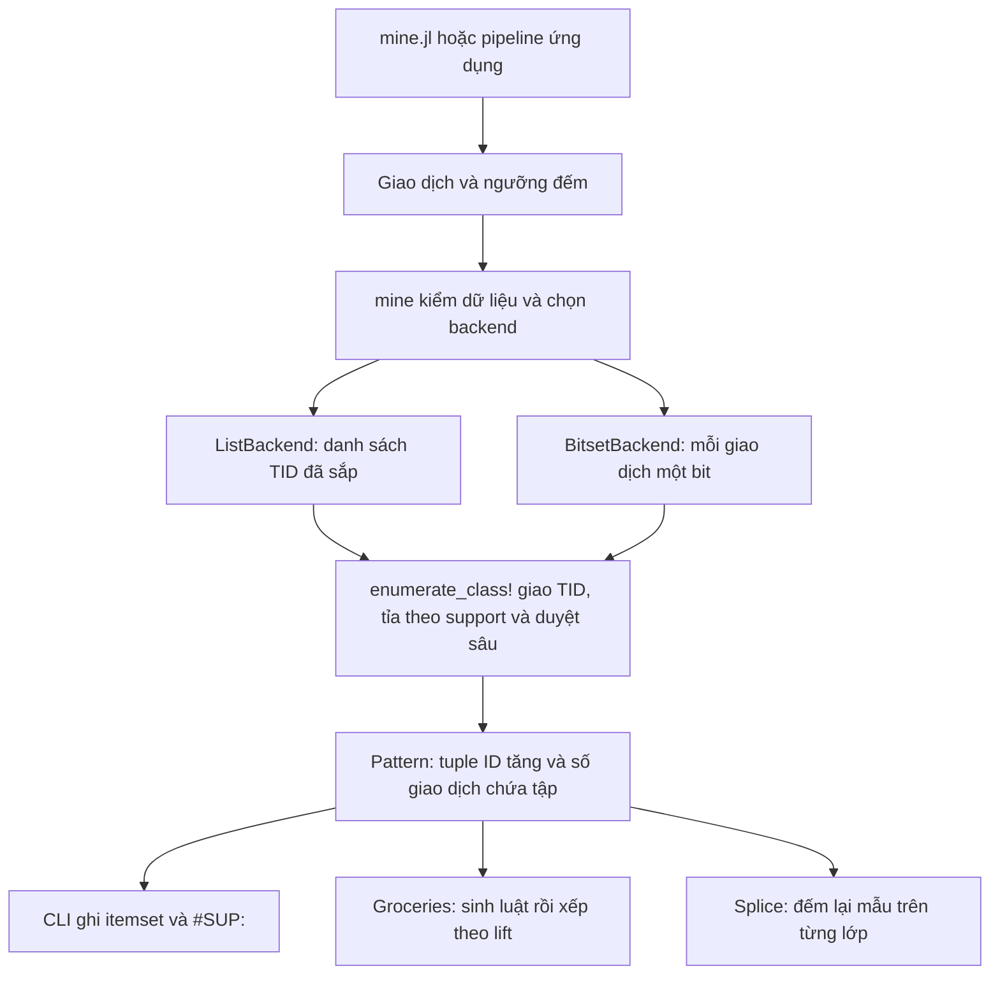

# Từ một giao dịch đến kết quả ECLAT

Ví dụ với `data/toy/basic.txt`, lệnh `julia --project=. scripts/mine.jl --input data/toy/basic.txt --output .tools/basic.txt --minsup 40% --backend list` đọc 5 giao dịch, giữ các tập xuất hiện ít nhất 2 lần và ghi 7 tập. Mỗi dòng dữ liệu có một mã giao dịch (TID) riêng. [Đầu vào](../data/toy/basic.txt) · [Kết quả SPMF](../tests/reference/spmf/)

`read_transactions` đọc định dạng SPMF. `minimum_count` đổi minsup tương đối sang số nguyên bằng phép làm tròn lên. Trong DFS, một `Vector{Int}` giữ các item trên đường đang duyệt. Mỗi atom giữ item mở rộng và tidset của cả tập. Khi xuất kết quả, DFS chụp tiền tố thành tuple bất biến. Sau khi quay lui, kết quả đã xuất vẫn giữ đủ các item cũ. [Parser và API](../src/utils.jl) · [Kiểu dữ liệu](../src/structures.jl) · [Hợp đồng đầu ra](SCHEMA.md)

## Từ bài báo Zaki đến mã Julia

| Bài báo | Quyết định trong đồ án | Mã để đọc |
|---|---|---|
| §4.1, tr. 375. Đếm support bằng giao tidset | Giao danh sách sắp tăng bằng hai con trỏ. Backend BitVector thay phép giao bằng AND và đếm bit 1. | [Danh sách](../src/algorithm/baseline.jl) · [BitVector](../src/algorithm/bitset.jl) |
| §4.2, tr. 376–377. Các lớp có chung tiền tố | DFS chỉ ghép với item đứng sau. Nếu giao có support dưới ngưỡng, mọi tập mở rộng từ giao đó cũng dưới ngưỡng. | [enumerate_class!](../src/algorithm/baseline.jl) |
| §5.1–5.4, tr. 380–382. Sinh cặp và duyệt lớp con | Nhóm tính cặp từ hai singleton bằng giao trong RAM. Mã đi hết một nhánh rồi quay lui. Các lớp tổ tiên còn sống trong khi xử lý lớp con. | [Hai cách dựng singleton](../src/algorithm/) · [Giả mã và ví dụ, Chương 1](Report.pdf) |
| §7, tr. 383–388. Ảnh hưởng của dữ liệu và ngưỡng | Nhóm đo lại trên bốn benchmark với SPMF, thay số giao dịch Retail và độ rộng giao dịch tổng hợp. | [Giao thức](experiments.md) · [Số đo](../results/README.md) |

[Bài báo của Zaki (2000)](https://doi.org/10.1109/69.846291)

Hai backend dùng chung DFS nên cần một cách đếm độc lập để phát hiện lỗi chung. Bộ test so từng tập và support với vét cạn và năm bộ tham chiếu SPMF. Khi chạy đủ ba notebook, bước cuối đối chiếu kết quả mới của hai ứng dụng với các bảng dùng trong PDF. [Test miner](../tests/test_miner.jl) · [Pipeline ứng dụng](../src/applications/pipelines.jl) · [Kiểm tra bàn giao](../scripts/verify_delivery.py)
