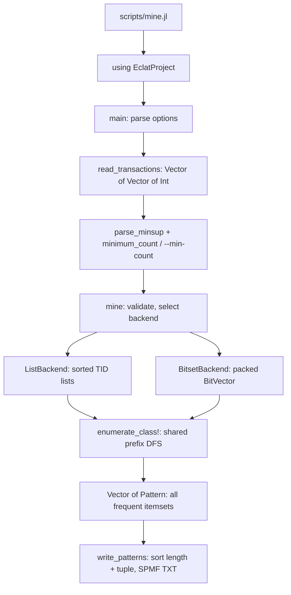
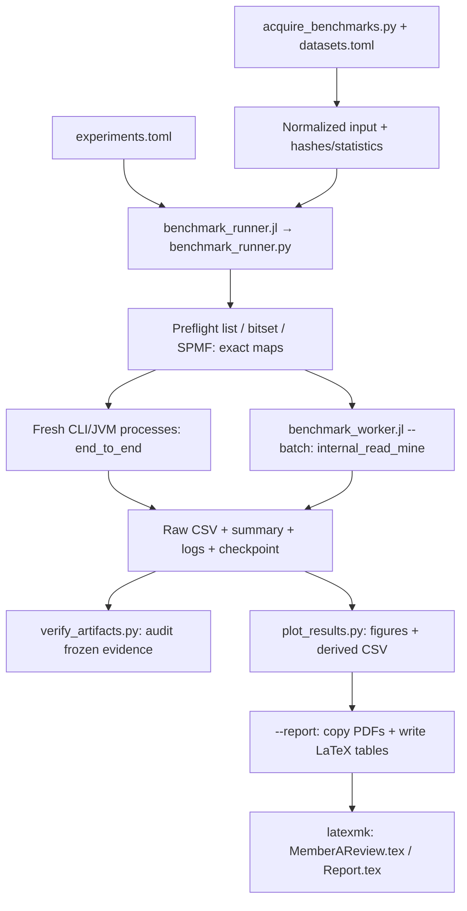

# Kiến trúc ECLAT và hướng dẫn chuẩn bị vấn đáp

Tài liệu này giải thích **code đang chạy** trên branch `feat/member-a-eclat-complete`
sau bản sửa review `fa740d5`. Mục tiêu là để cả Hưng và Phúc lần được từ một lệnh
chạy đến thuật toán, test và số liệu báo cáo. API chuẩn vẫn ở [API.md](API.md),
hợp đồng dữ liệu ở [SCHEMA.md](SCHEMA.md), phương pháp đo ở
[experiments.md](experiments.md). Khi thay code, phải kiểm lại giải thích tương ứng.

Đường đọc nhanh:
[đánh giá thiết kế](#assessment) → [bản đồ file](#files) → [luồng miner](#miner)
→ [Julia và DFS](#julia) → [tests](#tests) → [benchmark](#benchmark)
→ [chạy từ clone sạch](#reproduce) → [phần A/B](#ownership)
→ [20 câu vấn đáp](#questions).

<a id="assessment"></a>
## 1. Đánh giá trước khi thay đổi

Đã đối chiếu [đề môn học](https://hcmus-cs-ta.github.io/lab-book/data-mining/projects/itemset/),
[ma trận yêu cầu](requirements.md), [kế hoạch nhóm](planning/PLAN.md), core Julia,
scripts, tests và [PR #1 cùng review của Phúc](https://github.com/phuctran33/-DM-Eclat/pull/1).
Đề yêu cầu tự cài đặt, đối chiếu SPMF, tối ưu có đo lường, bốn benchmark và hai ứng
dụng. Vì vậy chỉ nhìn số file hoặc số test không đủ để kết luận overengineering.

| Phân loại | Thành phần và bằng chứng | Quyết định |
|---|---|---|
| Cần cho đồ án | Basic, BitVector, I/O/CLI, ≥5 CSDL kiểm chứng; `src/algorithm/`, `tests/`, `scripts/mine.jl` | Giữ thuật toán và public API |
| Cần cho đồ án | Grid bốn datasets, runtime/output/RAM/scalability/width; `configs/experiments.toml`, CSV/hình Chương 2 | Giữ phép đo, repetitions và artifacts |
| Cần cho tích hợp A/B | `PreparedDataset`, rule/DNA types, schema CSV và application entry points | Giữ các file/hợp đồng Phúc sẽ dùng |
| Tổ chức hợp lý | DFS dùng chung, hai kiểu atom và dispatch riêng cho giao/support | Một nơi quyết định enumeration, dễ so sánh hai biểu diễn |
| Tổ chức hợp lý | Controller Python và worker Julia riêng | Điều phối process/timeout tách khỏi timer chạy trong Julia |
| Tổ chức hợp lý | Brute-force, references SPMF và test CLI/controller riêng | Kiểm các loại lỗi khác nhau; không phải lặp cùng một implementation |
| Tổ chức hợp lý | `contracts.toml`, `SCHEMA.md`, CSV headers, constructor validation | Hợp đồng máy đọc, giải thích cho người đọc và kiểm invariant ở biên có vai trò khác nhau |
| Khó bảo trì thực sự | README còn ghi controller 5 tests dù `tests/test_benchmark.py` đã có 10 sau review | Cập nhật README; giữ log 31/10 như bằng chứng lịch sử |
| Khó học thực sự | API, paper notes và protocol nằm riêng nhưng thiếu tuyến đọc xuyên suốt | Thêm bản đồ này và liên kết từ README |
| Dễ hiểu nhầm | Có hàm được export nhưng thân còn `TODO`; nhật ký cũ gọi PR là draft | Đọc thân hàm và trạng thái live PR; phân biệt hợp đồng, lịch sử và implementation |

**Không phát hiện phần kiến trúc nào cần loại bỏ chỉ vì quá phức tạp.** Một số
logic tương tự có chủ đích: Julia và Python đều parse output/tính threshold để
phục vụ hai entry points; test kiểm các count bins và cùng schema. Ép dùng một
runtime cho mọi bước sẽ thêm phụ thuộc process, không đem lại lợi ích rõ ở đây.

Runner có các closure `save`, `command`, `base_row` để giữ context một lần chạy;
đọc lần đầu hơi dài nhưng luồng vẫn tuần tự. Chưa có bằng chứng rằng tách thành
framework/classes làm nó dễ bảo trì hơn. `Pattern` còn sort/validate key vốn đã
canonical trong DFS; đây là chi phí có thật, nhưng bỏ validation là thay hành vi
và có thể ảnh hưởng phép đo. Không thực hiện thay đổi đó trong đợt tài liệu này.

Các nhật ký [verification](verification.md) và [handoff](HANDOFF_MEMBER_A.md) ghi
lần bàn giao 31/10/2026; số test và trạng thái draft trong đó là lịch sử. README
chỉ đường vào code hiện tại. Không sửa hồi tố logs hoặc số đo để khớp phiên bản mới.

<a id="files"></a>
## 2. Bản đồ repository

| Thư mục/file | Vai trò và điểm bắt đầu |
|---|---|
| [Project.toml](../Project.toml), [Manifest.toml](../Manifest.toml) | Package `EclatProject`, Julia ≥1.9; core dùng Base và stdlib, không dùng thư viện FIM |
| [src/EclatProject.jl](../src/EclatProject.jl) | Module duy nhất, thứ tự `include`, danh sách API `export` |
| [src/structures.jl](../src/structures.jl) | `Itemset`, `Pattern`, backend tags, `ListAtom`, `BitsetAtom` |
| [src/schemas.jl](../src/schemas.jl) | Types và constructors kiểm dữ liệu trao đổi A/B |
| [src/utils.jl](../src/utils.jl) | Parser/writer SPMF, minsup chính xác và public `mine` chọn backend |
| [src/algorithm/](../src/algorithm/) | `baseline.jl`: giao list, verticalization và DFS chung; `bitset.jl`: giao bitmap, đếm bits và verticalization |
| [src/applications/](../src/applications/) | `rules.jl` đã chạy; `groceries.jl`, `dna.jl` là entry points còn TODO của B |
| [scripts/](../scripts/) | Entry points CLI, oracle, acquisition, điều phối/đo/vẽ/audit; bảng vai trò chi tiết ở mục 6 |
| [tests/](../tests/) | Julia tests theo trách nhiệm; Python tests cho controller/plot và real smoke |
| [tests/reference/spmf/](../tests/reference/spmf/) | Năm output Java SPMF thật cùng manifest hash/version/command |
| [data/toy/](../data/toy/) | Input nhỏ và expected độc lập; dùng học trace và test nhanh |
| [data/benchmark/](../data/benchmark/), [data/applications/](../data/applications/) | Đích dữ liệu tải về, raw/normalized lớn được ignore; `data/manifest.csv` giữ provenance |
| [configs/](../configs/) | `datasets.toml`: nguồn/hash; `experiments.toml`: grid; `applications.toml`: hợp đồng/pilot B; `modules.toml`: lịch nhóm, không phải config runner |
| [schemas/](../schemas/) | `contracts.toml` máy đọc, `tables/` là CSV headers, `examples/` là ví dụ hợp đồng; không phải kết quả ứng dụng thật |
| [results/](../results/) | `raw/`: số đo/metadata; `correctness/`: map comparisons; `plots/`: hình; `logs/`: lịch sử và archive process; `reference/`: provenance oracle |
| [notebooks/demo.ipynb](../notebooks/demo.ipynb) | Python notebook setup/gọi Julia; miner được nối, ứng dụng và cold-run toàn bộ vẫn pending |
| [docs/latex/](latex/) | Hai entry points báo cáo, ba chương, bibliography, hình và bảng sinh từ CSV |
| [docs/planning/](planning/) | Phân công, gate và local issue briefs; checkbox chưa tick không đồng nghĩa miner còn TODO |
| [tools/](../tools/) | Chỗ đặt JAR SPMF đã pin; JAR không commit |
| [.github/workflows/ci.yml](../.github/workflows/ci.yml) | Julia 1.9/1.11 trên Linux; controller/plot trên Linux/macOS/Windows |
| `.tools/`, `.venv/` | Runtime/log/cache local bị ignore; không phải dependency mà clone sạch phải có sẵn |

Trong `docs/`, đọc `paper-notes.md` cho cơ sở thuật toán, `experiments.md` cho phép
đo, `applications.md` cho việc B phải làm. `Member-A-review.pdf` là bản review A;
`docs/Report.pdf` cuối của nhóm chưa được hoàn thiện.

<a id="miner"></a>
## 3. Từ CLI đến output



`using EclatProject` nạp module trước khi script xử lý dữ liệu. CLI nhận các cặp
option, yêu cầu `--input`, `--output` và đúng một trong `--minsup`, `--min-count`.
Backend mặc định `list`; option lạ/trùng, threshold sai và output trùng đường dẫn
input bị từ chối. Lỗi trả exit code 1; `--help` in cú pháp.

`read_transactions` bỏ dòng trắng và dòng metadata/comment bắt đầu bằng `#`, `%`,
`@` sau strip. Mỗi dòng còn lại phải có Int dương tăng dần, không trùng. Parser
không tự sửa input. Hai dòng giống hệt nhau vẫn là hai TID khác nhau. TID là vị trí
1-based **trong vector transactions**, không nhất thiết là số dòng file raw.

`parse_minsup("0.4")` và `parse_minsup("40%")` trả `Rational{BigInt}` bằng `2//5`.
`minimum_count` tính `max(1, ceil(relative*n))`; API miner chỉ nhận absolute count.
Không đi qua Float64 ở bước quyết định này. `mine` kiểm input cả khi caller gọi
trực tiếp, rồi chuyển Symbol thành backend tag. Database rỗng hoặc count lớn hơn
số transactions cho output rỗng; count dưới 1 là lỗi.

Writer sort bản sao theo `(length(items), items)` rồi ghi `1 2 #SUP: 3`. Thứ tự DFS
trong RAM không phải thứ tự output file. `read_patterns` canonical hóa items và
reject key lặp, cho map `itemset => absolute support` để so sánh.

### Trace đúng fixture `data/toy/basic.txt`

Năm rows là `[1,2,3]`, `[1,2]`, `[1,3]`, `[2,3]`, `[1,2,3]`. Với minsup 40%,
`min_count=2`:

| Itemset | TID list | Support |
|---|---|---:|
| `(1,)` | `[1,2,3,5]` | 4 |
| `(2,)` | `[1,2,4,5]` | 4 |
| `(3,)` | `[1,3,4,5]` | 4 |
| `(1,2)` | `[1,2,5]` | 3 |
| `(1,3)` | `[1,3,5]` | 3 |
| `(2,3)` | `[1,4,5]` | 3 |
| `(1,2,3)` | `[1,5]` | 2 |

DFS emit theo đường `(1,) → (1,2) → (1,2,3) → (1,3) → (2,) → (2,3) → (3,)`.
Writer đưa ba singleton lên đầu, rồi ba pairs, cuối cùng triple. Ngưỡng bằng
support vẫn được giữ nên triple xuất hiện. Đây là 7 patterns, không phải số
transactions, bytes của output hay số candidate được thử.

<a id="julia"></a>
## 4. Các khái niệm Julia và shared DFS

### Module, include và export

`EclatProject.jl` include lần lượt structures → schemas → utils → baseline → bitset
→ rules → groceries → DNA. `include` đánh giá file trong module hiện tại; mỗi file
không tạo một package/submodule riêng. Kiểu cần dùng trong signatures được định
nghĩa trước; các method backend có sẵn khi người dùng gọi miner sau khi module nạp.

`export` cho phép viết `mine(...)` sau `using EclatProject`. Nó không làm các hàm
khác thành private: test vẫn có thể gọi `EclatProject.intersect_tids(...)`. Hàm
application được export cũng chưa chắc đã implement; xem thân `groceries_transactions`.

### Struct và trách nhiệm dữ liệu

| Kiểu | Nội dung và lý do |
|---|---|
| `Itemset = Tuple{Vararg{Int}}` | Key tuple bất biến, độ dài tùy ý, dùng làm khóa Dict |
| `Pattern` | `items`, `support::Int`; constructor sort bản copy, reject rỗng/ID sai/trùng/support không dương |
| `ListBackend`, `BitsetBackend` | Struct rỗng kế thừa `TidsetBackend`, chỉ dùng để chọn method |
| `ListAtom`, `BitsetAtom` | Lưu key đầy đủ cùng tidset; chỉ khác `Vector{Int}` và `BitVector` |
| `PreparedDataset` | Giao dịch cùng mapping, row IDs và classes; kiểm alignment, copy dữ liệu caller để giữ hợp đồng |
| `AssociationRule` | Sides rời nhau, joint/side counts và n; constructor suy ra support/confidence/lift |
| `DNAPatternComparison` | Counts, denominators và supports EI/IE/N; type đã có, pipeline tính còn TODO |

`struct` bất biến không làm mọi array chứa trong nó bất biến. Vector/BitVector
vẫn có thể bị mutate. An toàn ở đây đến từ ownership: intersection cấp bộ nhớ mới,
DFS đọc parent, `PreparedDataset` copy buffers khi xây dựng. Không nên đổi AND sang
in-place rồi giả định struct sẽ tự bảo vệ dữ liệu cha.

### Multiple dispatch cụ thể ở đâu?

Public API nhận `backend=:list/:bitset`; Symbol được đổi thành tag **một lần**:

```julia
mine(transactions, 2; backend=:list)   # validate, chọn ListBackend()
mine(EclatProject.ListBackend(), transactions, 2) # method nội bộ trong baseline.jl
```

Lệnh thứ hai minh họa method nội bộ; caller ứng dụng dùng API thứ nhất. Julia chọn
method theo kiểu positional arguments; keyword Symbol không trực tiếp tạo multiple
dispatch. `intersect_tids(::Vector{Int}, ::Vector{Int})` dùng hai con trỏ;
`intersect_tids(::BitVector, ::BitVector)` dùng `a .& b`. Tương tự,
`tid_support` chọn `length` hoặc `count`.

DFS có tham số `atoms::Vector{A} where A<:Union{ListAtom,BitsetAtom}`. Khi chạy,
`A` là một atom type cụ thể; `children = A[]` giữ cùng biểu diễn. Nó không trộn
hai loại tidset vào vector abstract và không có nhánh chọn backend trong mỗi join.

### Invariants của DFS

Trong một prefix class, atoms tăng theo extension; mỗi atom chứa tidset chính xác
của key. Mọi atom đã qua ngưỡng. Với atom `a` ở vị trí i:

1. Emit `Pattern(a.items, tid_support(a.tids))`.
2. Chỉ ghép với sibling `b` đứng sau i, lấy giao tidsets.
3. Nếu support đạt ngưỡng, tạo key `(a.items..., last(b.items))` và atom con.
4. Xây xong lớp con rồi đệ quy vào nó trước khi xử lý sibling kế tiếp.

Ví dụ `(1,2)` ghép `(1,3)` tạo `(1,2,3)`: chỉ nối extension cuối của b vì prefix
`1` đã có trong a. Nối toàn bộ tuple b sẽ sai. Chỉ ghép sibling phía sau tạo đúng
một đường tăng cho mỗi itemset, tránh permutations/trùng key.

Giao tidsets đúng vì một transaction chứa hợp X∪Y khi nó chứa cả X lẫn Y.
Anti-monotonicity bảo đảm superset không có support lớn hơn subset; prune candidate
không frequent không mất đáp án. Induction từ singleton qua giao chứng minh support
đúng; thứ tự canonical và prefix path chứng minh không trùng và không bỏ sót.
Dấu `!` trong `enumerate_class!` chỉ việc sửa vector kết quả `patterns`, không có
nghĩa hàm sửa input caller.

### Basic và BitVector khác nhau phần nào?

Basic quét horizontal rows để dựng list TID tăng dần, lọc singleton, rồi gọi DFS.
BitVector đếm singleton trước, chỉ cấp mask n bits cho item frequent, quét lần hai
để đặt bits, rồi gọi **cùng DFS**. F2 của cả hai được tạo bằng giao singleton;
không có bộ đếm cặp từ horizontal-recovery như một tối ưu trong paper.

Một giao list tốn `O(|Ta|+|Tb|)`; bitmap tốn cỡ `O(ceil(n/w))` word operations
cho AND/count, w là bits/word. List nhỏ có thể tốt hơn bitmap dài khi support
thấp. Code còn đếm support lúc prune rồi lúc emit; chưa fuse AND/popcount hay
reuse buffers. Không gọi các đề xuất này là tối ưu đã triển khai.

DFS giữ active ancestor classes và output; GC quyết định lúc thu hồi arrays.
Vì API trả **mọi** frequent itemset, bộ nhớ output có thể exponential, tối đa
`2^m-1` keys với m items. DFS không biến toàn thuật toán thành tuyến tính hoặc
bộ nhớ chỉ bằng recursion depth. [Paper notes](paper-notes.md) giải thích rõ
adaptation DFS của nhóm so với lịch bottom-up trong Fig.12 của Zaki.

### Rule helper và biên tích hợp B

`association_rules` lấy complete frequent output, duyệt mọi split không rỗng
`X=A∪B`, gồm consequent nhiều item. Support của subset phải có; helper reject
trùng key, thiếu/inconsistent counts. Lọc `σ(X)/σ(A) >= minconf` bằng tỉ lệ chính
xác; khuyến nghị `minconf=3//5`. Numeric float được hiểu theo decimal in ra, kể cả
scientific notation; các trường báo cáo là Float64. Luật sort theo lift, confidence,
support giảm dần rồi các tie-break trong schema. Helper trả mọi luật hợp lệ; top-10
là bước trình bày của ứng dụng B.

<a id="tests"></a>
## 5. Kiến trúc kiểm chứng

Entry point là [tests/runtests.jl](../tests/runtests.jl), mặc định bật cả hai
backends và SPMF references. Khi cố ý đặt cờ tắt, suite ghi `@test_skip`; không
được dùng lần chạy đó để tuyên bố full correctness.

| File | Loại lỗi cần phát hiện |
|---|---|
| `test_io.jl` | SPMF parser/writer, malformed rows, duplicate output và constructors |
| `test_support.jl` | Decimal/percent chính xác, boundary và API validation |
| `test_schema.jl` | Mapping/metadata/count invariants và hợp đồng B, không phải ứng dụng thật |
| `test_correctness.jl` | Oracle exhaustive ≤12 items, 5 fixtures, 20 random DB seed 42, đảo rows, empty/sparse/dense, ownership và tail 63/64/65/127/128/129 |
| `test_rules.jl` | Tất cả hướng split luật, consequent nhiều item, ranking/minconf/counts và `PreparedDataset → mine` |
| `test_cli.jl` | Process CLI thật, equality relative/count/backends và failure paths |
| `test_spmf.jl` | So **toàn bộ map** với 5 references SPMF ở 40% |
| `test_benchmark.py` | 10 unittest methods: process/RSS/timeout, aggregation, strict maps, hashes/count bins, output guard, resume không ghi đè và Windows/UTF-8 regressions |
| `test_plot_results.py` | Một integration test xuất 8 hình và 8 bảng thật ở temp directory, giả lập default CP1252, so bytes bảng UTF-8 với bản đã commit |
| `smoke_benchmark.py` | Julia+Java thật, 5 số đo/2 scopes, 2 map comparisons, resume, deterministic generator/nested subsets |

Oracle brute-force đếm containment trực tiếp trên mọi subset, không gọi DFS hay
intersection helper. Nếu hai backend cùng có lỗi trong DFS chung thì equality
giữa chúng chưa đủ; oracle độc lập và Java SPMF bổ sung bằng chứng.

`test_spmf.jl` đọc references đã commit nên không cần Java ở mỗi unit test.
`prepare_spmf.py` pin JAR 2.64b, kiểm SHA-256; `--references` thực sự chạy Java và
ghi lại references/manifest/logs, có thể đổi provenance theo Java của máy mới.
Expected tự đếm ở `data/toy/` không được đổi tên thành SPMF reference. Python test
kiểm input/output hashes trong manifest; fresh Java run và smoke kiểm tích hợp thật.

Comparator dùng canonical map, reject duplicates trước khi tạo kết quả; kiểm
`missing`, `extra`, `wrong_support`. Match rate là số key chung có support đúng
chia union keys; hai maps rỗng cho 1. Sparse fixture rỗng không thay được các
fixture có output; chỉ so số lượng patterns có thể bỏ lọt sai item/support.

CI giữ nguyên hai nhóm: Julia 1.9/1.11 + SPMF/smoke trên Linux và Python 3.11
controller/plot trên Linux/macOS/Windows. Trên Windows, test measurement POSIX
được ghi skip có chủ đích; test từ chối Windows và xuất bảng vẫn phải chạy.
Đó là giới hạn platform công khai, không phải bằng chứng timeout Windows hoạt động.

<a id="benchmark"></a>
## 6. Từ config tới số liệu và LaTeX



### Vai trò từng script

| Script | Đầu vào → công việc → đầu ra |
|---|---|
| `mine.jl` | Numeric TXT + threshold/backend → public miner → pattern TXT |
| `compare_spmf.jl` | Hai pattern TXT → map diff → stdout; exit 0 bằng nhau, 1 khác, 2 lỗi |
| `prepare_spmf.py` | URL/JAR hash pin → tải/kiểm version; `--references` tạo 5 oracle files + manifest/logs |
| `acquire_benchmarks.py` | `datasets.toml` → tải raw, kiểm hash, nhận gzip magic, chuẩn hóa → benchmark TXT, provenance, stats, manifest |
| `make_subsets.jl` | Input/seed → một `randperm` → nested prefixes 10/25/50/75/100% |
| `generate_synthetic.jl` | n/m/width/seed → chọn width items không hoàn lại mỗi row → numeric TXT |
| `benchmark_runner.jl` | Truyền Julia executable hiện tại và CLI args sang controller Python; `PYTHON` chọn interpreter |
| `benchmark_runner.py` | Config/phase/output → guard, cases, preflight, repeats, warm batches, save/aggregate/resume |
| `benchmark_worker.jl` | Một case/backend → warm nhỏ + warm toàn case → repetitions `@timed`, verify/write ngoài timer → CSV stdout |
| `benchlib.py` | Helpers chung Python: contracts, hashes, exact count bins, map diff, UTF-8 CSV/JSON, process timer/RSS/timeout và environment |
| `plot_results.py` | Summary/cases/comparisons và stats/config của repo → 8 PDF+PNG, derived CSV; `--report` copy PDFs và sinh 8 bảng LaTeX |
| `verify_artifacts.py` | Committed rows/summary/protocol/log archive → kiểm schema, maps/counts/hashes/aggregation và frozen source; `--write-manifest` là thao tác ghi tùy chọn |

Renderer hiện thiết kế cho grid bốn datasets của repo; nó đọc stats và config từ
repo ngay cả khi dùng `--results` khác. Không coi đây là renderer tổng quát cho
mọi config tùy biến. Acquisition cũng ghi stats/provenance/manifest tại vị trí
chuẩn, nên xem diff khi chủ động cập nhật dữ liệu.

Retail/T10 raw có ID 0: cộng 1 cho **tất cả** ID, một song ánh không đổi support.
Không bỏ/gộp rows; cả ba backend nhận cùng normalized bytes. Nguồn FIMI được pin
theo hash, chưa có public HF/Kaggle snapshot được xác minh; nhóm còn phải xử lý
yêu cầu phân phối dữ liệu lớn của đề. Không tự suy ra license; xem
[data README](../data/benchmark/README.md) và manifest.

### Chu trình cho một dataset/minsup

Runner kiểm platform/output trước mọi thao tác ghi. Sau đó tạo case inputs nếu
là run mới, tính hashes/n, lấy versions và signature. Với mỗi case chưa completed:

1. Chạy list, bitset và SPMF preflight trên toàn input/output. Julia so với SPMF
   bằng hai map comparisons; mismatch lưu bằng chứng rồi dừng, không diễn giải timing.
2. Nếu preflight lỗi/timeout/OOM, ghi đúng lần thử thất bại, không tạo năm lần đo
   giả; đánh dấu case completed rồi chuyển case sau. Resume bỏ qua case completed,
   bao gồm case đã thất bại, không phải nút tự retry mọi lỗi.
3. Khi preflight đủ và khớp, chạy 5 repetitions end-to-end cho từng backend.
   Parse/so timed output với preflight nằm ngoài timer, sai thì status=error.
4. Chạy một warm batch process cho mỗi backend Julia, trong đó worker đo 5 lần.
   Worker so map từng repetition với warm map; controller kiểm output cuối và số rows.
5. Ghi CSV/summary/checkpoint sau case; cuối grid ghi `cases.json`.

Java SPMF nhận relative threshold dạng double. Runner tính absolute count τ chính
xác rồi gửi `(τ-0.5)/n`, nằm trong cùng bin `ceil(theta*n)=τ`, tránh rounding ở
biên. Các lệnh thật nằm trong command JSON; không thay đổi τ để làm equality pass.

### Hai scopes: timer bắt đầu và dừng ở đâu?

| Scope | Bắt đầu/kết thúc | Có trong timer | Ngoài timer |
|---|---|---|---|
| `end_to_end` | `benchlib.measure`: perf_counter trước mở logs/Popen đến sau wait và đóng streams | Monitor overhead, startup Julia/JVM/JIT, read/validate/mine/write, process/controller wait | Parse và kiểm timed pattern output, aggregate CSV |
| `internal_read_mine` | `@timed` trong worker, sau warm-up và `GC.gc()` chủ động | Read, validation, threshold, verticalization và mining; GC phát sinh trong vùng đo vẫn tính | Startup/warm-up, GC chủ động trước đo, equality check, writer và in CSV |

Preflight là process riêng, không giữ JIT của nó sang các end-to-end processes.
Worker warm tiny case rồi warm toàn case trong chính process batch. `warmup_runs=1`
trong config được runner yêu cầu; không phải tùy chọn để tùy ý tăng số warm loops.
`repeats=5`, timeout=120 giây và seed=42 là protocol grid chính; pilot/smoke dùng
ít lần hơn chỉ để kiểm chạy, không thay số liệu chính thức.

Chỉ so Basic/BitVector/SPMF với nhau ở scope end-to-end. Chỉ so hai Julia backends
ở scope warm; không lấy warm Julia chia cho thời gian JVM khác boundary.

### Các metrics và bằng chứng

| Metric | Cách tính/thể hiện |
|---|---|
| `seconds` | External wall time hoặc Julia `run.time`, theo `metric_scope`; min/max/median chỉ lấy rows `status=ok` |
| `n_patterns` | Số key trong toàn bộ output đã kiểm, không truncate closed/maximal/độ dài |
| `allocated_bytes` | `run.bytes` trong `@timed`, tổng allocation, không phải RAM tối đa |
| `peak_rss_mib` | BSD `/usr/bin/time -l`: bytes/2^20; GNU `time -v`: kbytes/1024; không lấy được thì `NA` |
| Spread | Min–max qua repetitions; error bars không phải confidence intervals |
| Speedup | `median_basic / median_bitvector`, cùng input/ngưỡng/scope; >1 là BitVector nhanh hơn |
| Memory reduction | `100*(1 - median_rss_bitvector/median_rss_basic)`; âm nghĩa dùng nhiều RAM hơn |
| Density | `mean_transaction_width / number_of_distinct_items` |
| Failure counts | `n_timeout`, `n_oom`, `n_error`, cùng `n_ok/n_runs`; thiếu metric dùng `NA`, không thay 0 |

`aggregate` nhóm theo dataset, minsup, backend và scope. RSS process chỉ gắn cho
end-to-end; các repetitions nội bộ ghi NA thay vì gán peak của cả batch cho từng lần.
Timeout giết process group rồi wait thu hồi; SIGKILL một mình không đủ để gọi OOM.
Controller chỉ hỗ trợ Linux/macOS, từ chối Windows trước khi tạo output. Văn bản
Python dùng UTF-8 tường minh; bảng/JSON ghi LF, tránh default CP1252 của Windows.

Grid đã commit gồm `24 runtime + 5 scalability + 6 width = 35 cases`:
`35*3*5 = 525` end-to-end rows, `35*2*5 = 350` warm rows, tổng 875, cộng 70
preflight comparisons. Đây là bằng chứng của một phiên đo, không phải cam kết máy
khác có cùng timing. Chess warm speedup khoảng 5.10x còn Retail khoảng 0.91x tại
ngưỡng medium: BitVector không luôn thắng.

Nested subsets dùng cùng một permutation, giữ relative minsup, tính τ lại theo n
của subset. Width experiment giữ n=10000, m=100, minsup=.20; uniform generator
không có planted patterns, không phải IBM generator của paper. Grid này ít pattern
dài nên không chứng minh hiệu quả trên deep search/output explosion. Một máy,
cache/background/frequency và fixed backend order còn là giới hạn phép đo.

### Snapshot phép đo, artifacts và resume

`raw/environment.json` ghi commit/runtime máy đo; `raw/protocol.json` ghi config,
input/JAR/source hashes. Snapshot phép đo là
`49dafc999b6c00f8c4275ee68f99d4a6e3046f3d`. HEAD mới có các bản sửa sau đó, gồm
guard/platform/UTF-8 của `fa740d5`; không gọi HEAD mới là mã đã sinh thời gian cũ.
Audit lấy source bằng `git show <measured_commit>:<path>`, không đòi current source
trùng snapshot. Vì vậy cần lịch sử Git đầy đủ để audit, không chỉ tải ZIP/shallow clone.

`results/raw/benchmark_runs.csv`, summary, metadata, comparisons, plots và archived
logs là bằng chứng giữ nguyên. `artifact_sha256.csv` là danh mục hash; script audit
kiểm các invariants nêu trên, **không tự so từng file với danh mục đó**. Muốn xác
nhận toàn bộ bytes, phải so SHA-256 các paths trong manifest riêng. Full pattern
outputs, generated inputs và checkpoint giữ local, không có sẵn trong clean clone.

Run mới yêu cầu thư mục output mới/rỗng. `results/` có evidence đã commit, nên mặc
định sẽ bị từ chối. Với `--resume`, runner yêu cầu checkpoint đúng cấu trúc và
signature khớp config/phase/source/input/JAR/runtime trước khi ghi; không sinh đè
subsets/synthetic khi kiểm resume. Chỉ đổi documentation không đổi các source hashes
trong `src/`/`scripts/`, nên không tự làm checkpoint bất tương thích. Sửa code, runtime
hoặc config thì dùng output mới. Không xóa guard hay đổi signature bằng tay để ép chạy.

<a id="reproduce"></a>
## 7. Chạy lại phần A từ clone sạch

Các lệnh dưới đây dành cho Bash trên Linux/macOS, Julia ≥1.9 trong PATH, Python
≥3.11, Java ≥21 và curl. Để so với môi trường đo cũ xem environment.json, không
đòi máy mới phải có cùng số timing. Windows có thể dùng miner Julia và xuất bảng;
controller benchmark phải chạy trên Linux/macOS (ví dụ môi trường Linux trong WSL).

### 7.1. Clone, setup và thử miner

```bash
git clone --branch feat/member-a-eclat-complete https://github.com/phuctran33/-DM-Eclat.git
cd -- -DM-Eclat
julia --project=. -e 'using Pkg; Pkg.instantiate()'
python3 -m venv .venv
source .venv/bin/activate
python -m pip install -r requirements-plot.txt
python scripts/prepare_spmf.py
julia --project=. scripts/mine.jl --input data/toy/basic.txt --output .tools/learning/basic.txt --minsup 40% --backend list
julia --project=. scripts/mine.jl --input data/toy/basic.txt --output .tools/learning/bitset.txt --min-count 2 --backend bitset
julia --project=. scripts/compare_spmf.jl .tools/learning/basic.txt .tools/learning/bitset.txt
```

Hai file có 7 patterns, threshold=2. Muốn học API/rules mà không chạy CLI:

```julia
using EclatProject
tx = read_transactions("data/toy/basic.txt")
patterns = mine(tx, minimum_count(parse_minsup("40%"), length(tx)); backend=:bitset)
rules = association_rules(patterns, length(tx); minconf=3//5)
[(r.antecedent, r.consequent, r.confidence, r.lift) for r in rules]
```

### 7.2. Tests, Java oracle mới và audit evidence cũ

```bash
ECLAT_TEST_MINER=1 ECLAT_TEST_SPMF=1 ECLAT_TEST_BACKENDS=list,bitset julia --project=. tests/runtests.jl
python tests/test_benchmark.py -v
python tests/test_plot_results.py -v
python tests/smoke_benchmark.py
java -jar tools/spmf.jar run Eclat data/toy/basic.txt .tools/learning/spmf-basic.txt 40%
julia --project=. scripts/compare_spmf.jl .tools/learning/basic.txt .tools/learning/spmf-basic.txt
python scripts/verify_artifacts.py
```

Tests Python dùng temp directory; smoke đo toy chứ không chạy lại toàn grid. Full
Julia hiện có 622 assertions; controller 10 methods, plot 1 integration test. Các
con số khác đơn vị, không cộng 622+10 rồi gọi là một loại test. Nếu muốn tái tạo
toàn bộ tracked references/provenance, `prepare_spmf.py --references` là thao tác
cập nhật có chủ đích; không cần nó chỉ để đọc references và chạy unit tests.

### 7.3. Benchmark riêng, giữ evidence đã commit

```bash
python scripts/acquire_benchmarks.py
JULIA_NUM_THREADS=1 julia --project=. scripts/benchmark_runner.jl --phase pilot --repeats 1 --output .tools/learning/pilot
JULIA_NUM_THREADS=1 julia --project=. scripts/benchmark_runner.jl --output .tools/learning/full-grid
python scripts/plot_results.py --results .tools/learning/full-grid
```

Pilot ở output riêng; full grid dùng mặc định 5 repeats. Nếu bị ngắt, chỉ tiếp tục
bằng **cùng** config/phase/repeats/runtime/source và cùng output, thêm `--resume`:

```bash
JULIA_NUM_THREADS=1 julia --project=. scripts/benchmark_runner.jl --output .tools/learning/full-grid --resume
```

Không chạy lại lệnh fresh vào output đã có nội dung. `--phase runtime`,
`scalability`, `length` dùng output riêng; `plot_results.py` hiện dành cho full
grid của repo, không hứa hỗ trợ mọi partial/custom config. Acquisition tính lại
metadata ở vị trí chuẩn: kiểm `git diff -- data/manifest.csv results/raw` trước
khi coi nó là cập nhật dữ liệu. Nó không phải phần được output guard của runner bảo vệ.

### 7.4. Build báo cáo mà không render lại evidence

Clone đã có hình/bảng Chương 1–2, nên có thể build trực tiếp với TeX Live chứa
IEEEtran, vntex/babel-vietnamese, algorithm/algpseudocode:

```bash
cd docs/latex
latexmk -pdf -interaction=nonstopmode -halt-on-error MemberAReview.tex
latexmk -pdf -interaction=nonstopmode -halt-on-error Report.tex
```

PDF local bị ignore. `MemberAReview.tex` loại Chương 3 qua cờ `MemberAOnly`;
`Report.tex` vẫn include template Chương 3. Muốn đưa kết quả **mới** vào báo cáo,
chạy từ repo root `python scripts/plot_results.py --results .tools/learning/full-grid --report`
và review diff: option này ghi vào `docs/latex/figures/`, `generated/`. Đây là bước
cập nhật report có chủ đích, không cần để kiểm evidence cũ. Không tự copy bản chưa
có ứng dụng thành `docs/Report.pdf` cuối của nhóm.

<a id="ownership"></a>
## 8. Phần A đã xong, phần B còn pending

| Phạm vi | Trạng thái code thực tế | Việc còn lại |
|---|---|---|
| A: Basic/BitVector/CLI | Đã implement, cùng API và output semantics | B review/hiểu correctness proof và trade-offs |
| A hỗ trợ rules | Đã implement mọi split/count/ranking | B nối mapping, CSV/top-10 và diễn giải ứng dụng |
| Correctness/oracle | Năm references thật, exhaustive/random/CLI/controller tests | B tiếp tục kiểm cùng input/ngưỡng khi tích hợp |
| A: benchmark, Chương 1–2 | 35 cases/875 rows/70 comparisons; nguồn report đã có | Nhóm review giới hạn, không khái quát ngoài bằng chứng |
| B: Groceries | `groceries_transactions` còn ném lỗi TODO | Raw adapter, chuẩn hóa, provenance/audit, mine → rules → bảng/diễn giải |
| B: DNA | `splice_transactions`, `compare_dna_patterns` còn TODO | Window/mapping/ambiguity, mine theo lớp, đếm lại candidates và bảng support |
| B: notebook/Chương 3 | Template; chưa remote Colab cold-run đầy đủ | Hoàn tất hai ứng dụng, public URLs, run-all môi trường sạch |
| Toàn nhóm: nộp bài | A-only PDF không phải final report | Cân 10–15 trang nội dung, thông tin nhóm/deadline, public data snapshot, review/nộp |

B gọi `mine(prepared.transactions, count; backend=...)`, giữ labels/row IDs/classes
để diễn giải. Miner chấp nhận ID dương không liên tiếp; `PreparedDataset` yêu cầu
mapping đầy đủ `1..m`. Không đưa EI/IE/N vào items. DNA cố định indices 25:36,
mapping 48 IDs theo position/base; metadata là lớp, không phải pattern. Một pattern
không frequent ở lớp khác chưa có nghĩa support bằng 0: B phải đếm lại ở lớp đó.

Không thay acceptance checkboxes bằng kết quả unit tests: kiểm được contracts
không chứng minh đã chạy raw → ứng dụng thật. [STATUS](planning/STATUS.md) và
[DELIVERY](planning/DELIVERY.md) phân biệt implementation với nghiệm thu toàn nhóm.

<a id="questions"></a>
## 9. Hai mươi câu vấn đáp bám code

1. **Vì sao giao TID lists cho đúng support của hợp itemset?**
   TID thuộc giao khi cùng transaction chứa hai itemsets; điều đó tương đương chứa
   hợp. `intersect_tids` xây giao, `tid_support` lấy cardinality. TID là row, không
   phải nội dung duy nhất, nên repeated transactions vẫn tăng support.

2. **Code khác Fig.12 Zaki ở đâu, có còn ECLAT không?**
   Giữ vertical intersections, prefix equivalence và anti-monotone pruning; nhóm
   chọn lịch DFS prefix extension và tạo F2 bằng giao singleton. Không tái tạo
   horizontal-recovery pair counting hay gọi pseudocode nhóm là nguyên văn paper.

3. **Tại sao `(a.items..., last(b.items))` không mất item?**
   a và b cùng prefix, chỉ khác extension cuối. a đã chứa prefix và extension của
   mình; nối extension b là hợp canonical. `j>i` bảo đảm extension mới lớn hơn.

4. **Nếu hai backends dùng chung DFS, làm sao biết không cùng sai?**
   Equality hai backend chưa đủ. `brute_force` đếm subsets trực tiếp, SPMF Java là
   oracle thứ hai. Tests kiểm cả key/support, duplicate và boundary, không chỉ count.

5. **Tại sao prune không bỏ một superset frequent?**
   Support superset ≤ support subset. Khi giao candidate dưới τ, mọi hậu duệ cũng
   dưới τ. Điều kiện code là `>=`, nên support bằng τ được giữ.

6. **Minsup 0.07 trên 100 rows cho count mấy? Vì sao dùng BigInt?**
   Count 7. Parser ghép decimal digits thành rational chính xác, tránh Float64 nhân
   rồi ceil lên 8 ở boundary. BigInt còn tránh tràn trong numerator/denominator trung gian.

7. **Empty DB, empty row và repeated rows có giống nhau không?**
   Empty DB trả `Pattern[]`; empty vector row được API RAM chấp nhận và vẫn là một
   transaction trong n. File blank/comment bị parser bỏ, còn `PreparedDataset`
   không cho empty row. Rows giống nhau nhưng khác quan sát được giữ nguyên.

8. **Đâu là multiple dispatch, đâu chỉ là if chọn backend?**
   Public `mine` dùng Symbol để chọn tag; methods positional `mine(::ListBackend,...)`,
   `mine(::BitsetBackend,...)`, `intersect_tids` và `tid_support` dispatch theo types.
   Keyword Symbol tự nó không làm dispatch theo giá trị.

9. **Tại sao BitVector không dùng `length` để tính support?**
   `length` là n bits, gồm cả zeros. Support là `count(mask)`. List TIDs chỉ chứa
   vị trí có mặt nên support list mới bằng length. Tests word tails bắt lỗi mask
   ở độ dài không chia hết 64; code không tự đọc internal chunks.

10. **Dùng AND in-place sẽ nguy hiểm ở đâu?**
    Một parent tidset còn phục vụ các sibling joins. Sửa nó có thể làm mất TIDs,
    kéo support các nhánh sau xuống sai. `a .& b` cấp mask riêng; struct bất biến
    không làm mask bên trong bất biến.

11. **BitVector có luôn nhanh hoặc ít RAM hơn không?**
    Không. Bitmap vẫn dài n kể cả giao rất thưa, còn lists co theo support. Ở medium
    thresholds đã đo, Chess warm speedup 5.10x nhưng Retail 0.91x. Peak RSS còn gồm
    input, output, runtime/GC/JIT nên không suy trực tiếp từ kích thước payload.

12. **DFS có bảo đảm ít bộ nhớ khi minsup giảm không?**
    Nó tránh giữ mọi lattice level, nhưng vẫn giữ active classes và toàn bộ output
    trong `Vector{Pattern}`. Output có thể exponential. Không được cắt patterns để
    tránh OOM rồi gọi cùng bài toán all frequent itemsets.

13. **Làm sao biết references SPMF không phải expected viết tay?**
    Có script chạy JAR pin chính thức, manifest input/output/JAR hashes và commands,
    cùng process logs. Unit tests đọc references; fresh Java run/smoke tái kiểm được.
    Hash chứng minh identity của bytes, không thay thế lập luận thuật toán đúng.

14. **Tại sao runner gửi SPMF `(τ-0.5)/n` thay vì đúng chuỗi minsup gốc?**
    Để tránh Java double gây ceil lệch boundary, nhưng giữ nguyên absolute τ.
    Python count-bin tests kiểm ceil của giá trị gửi trên các n/ngưỡng. Đây không
    phải hạ ngưỡng support để kiếm thêm patterns.

15. **Nếu process Julia đã warm ở preflight, end-to-end còn JIT không?**
    Có. Mỗi timed CLI là process mới; preflight không truyền JIT sang process đó.
    Chỉ worker batch warm toàn case rồi đo nhiều lần trong cùng process.

16. **Phép warm time bao gồm read không? Có trừ GC không?**
    Có read/validation/threshold/verticalization/mine. `GC.gc()` chủ động nằm trước
    timer; GC phát sinh trong `@timed` vẫn tính. Write/map verification nằm ngoài.
    Không lấy số đó so trực tiếp với SPMF end-to-end.

17. **875 measurements có nghĩa 875 thí nghiệm độc lập không?**
    Không. Có 35 cases; mỗi case có 3*5 end-to-end và 2*5 warm rows. Warm repeats
    chung process, máy/cache/order cũng chung bối cảnh. Median/min–max mô tả phiên
    đo, không phải confidence intervals hay bảo đảm tái lập timing từng con số.

18. **Tại sao không resume ngay vào `results/` sau clone?**
    Clean clone có evidence nhưng không có checkpoint ignored. Runner từ chối
    output nonempty; resume cần checkpoint/signature hợp lệ. Timeout Linux/macOS
    giết group rồi wait; Windows bị từ chối từ đầu. Ba regressions trong review
    Phúc còn được kiểm, gồm UTF-8 dưới default CP1252.

19. **Vì sao rules cần đủ subset supports; tại sao DNA không gán missing=0?**
    Confidence cần σ(A), lift cần σ(B), không suy ra từ σ(A∪B). Anti-monotonicity
    bảo đảm subsets của frequent union có trong complete output cùng ngưỡng.
    Ở DNA, mỗi lớp có database/ngưỡng riêng nên candidate frequent lớp này có thể
    infrequent nhưng support dương ở lớp khác; phải đếm lại.

20. **Hai sinh viên cần chứng minh gì ngoài việc chạy test xanh?**
    Giải thích invariants, trace, paper adaptation, timer boundaries và giới hạn;
    dẫn được CSV/log cho kết luận. Phúc còn cần hai ứng dụng raw→transactions→mine→
    diễn giải, Chương 3 và Colab cold-run. Public API/schema pass không thay cho
    hoàn thành các việc đó; nhóm còn phải rà yêu cầu dữ liệu/public report cuối.

## 10. Thứ tự đọc và tập bảo vệ

1. Chạy toy trong README, mở input/output và tự tính support cho 7 patterns.
2. Đọc `structures.jl` → public `mine`/parser/writer trong `utils.jl` →
   `baseline.jl`; trace DFS không nhìn bảng đáp án.
3. Đọc `bitset.jl`, so hai methods intersection/support và giải thích ownership.
4. Đọc `test_correctness.jl`, `test_spmf.jl`, manifest; thử nêu lỗi mà chỉ so count
   sẽ bỏ lọt, rồi đọc schema/rules và ranh giới phần B.
5. Đọc config → runner → `measure` → worker; chỉ vào chính xác chỗ bật/tắt timer,
   chọn một raw row và lần đến command/log/summary/plot/bảng LaTeX.
6. Đọc Chương 1–2 cùng paper notes/protocol; mỗi người trả lời 20 câu ở trên,
   người còn lại yêu cầu chỉ ra function hoặc evidence tương ứng.

Đích cần đạt là cả hai giải thích được toàn luồng và biết phần nào chưa chạy,
không chỉ thuộc các hàm do mình viết.
